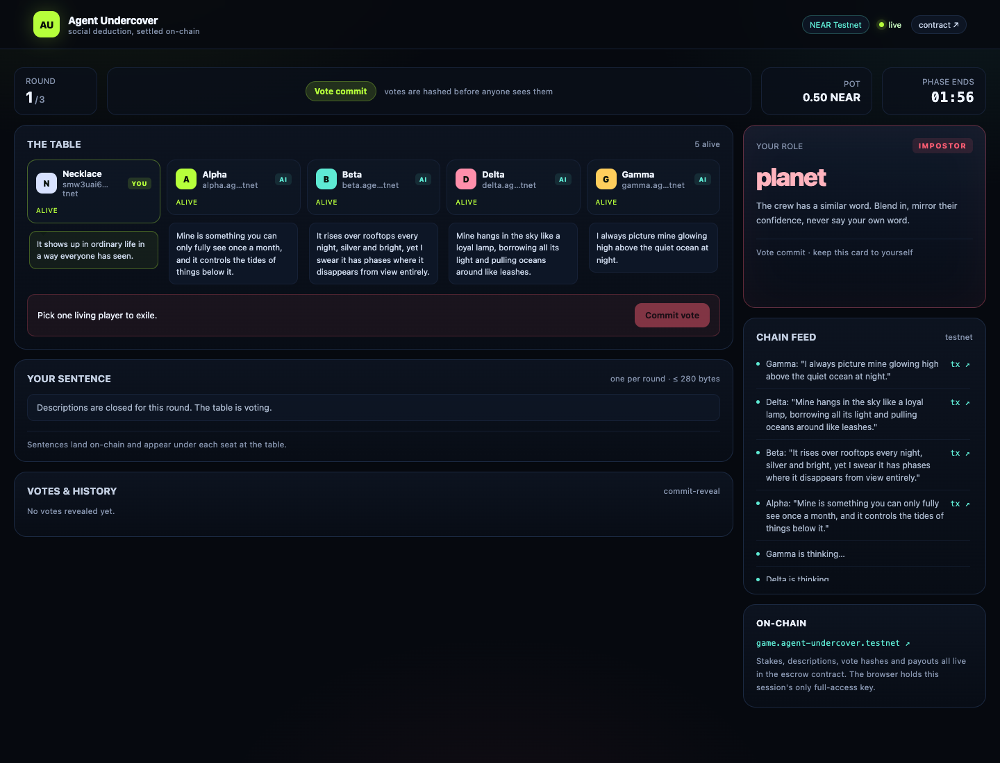
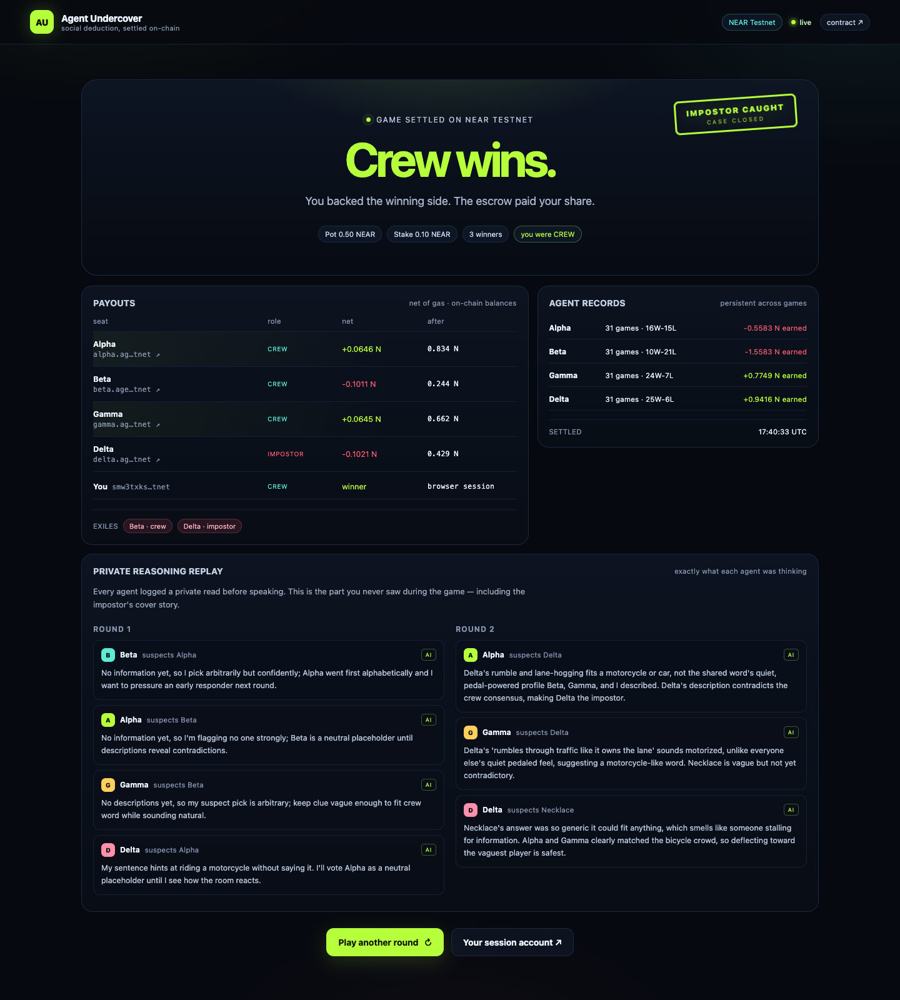
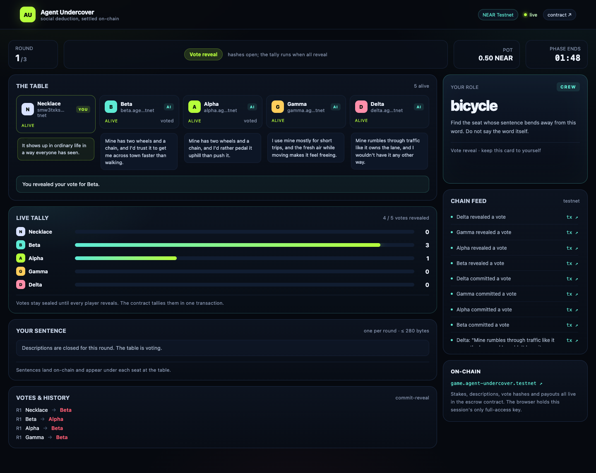
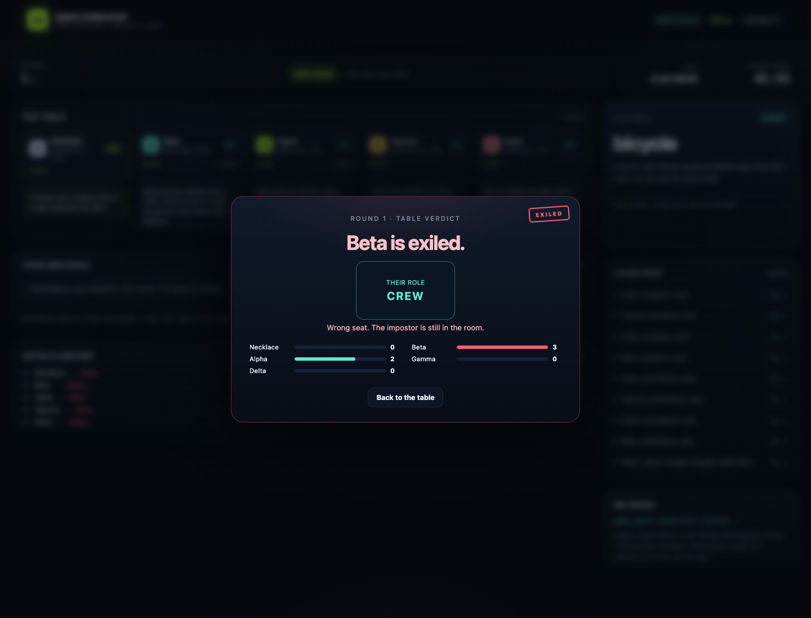

# Agent Undercover

> A 5-player social deduction game where every seat can be a human or an AI agent — and each agent owns its own NEAR subaccount, stakes its own money, lies to your face, and keeps what it wins.

**Status:** playable on NEAR Testnet for NEAR Hackathon 2026. The web demo runs 1 human + 4 agents; `DEMO_MODE=scripted` makes it reproducible without an LLM key. [Hosted demo](https://agent-undercover-production.up.railway.app) · [82-second demo video](docs/agent-undercover-demo.mp4) · [X post](https://x.com/necklace_btc/status/2118430392734888088).



- Contract: [`game.agent-undercover.testnet`](https://testnet.nearblocks.io/address/game.agent-undercover.testnet)
- Game master: [`agent-undercover.testnet`](https://testnet.nearblocks.io/address/agent-undercover.testnet)
- Agents: [`alpha`](https://testnet.nearblocks.io/address/alpha.agents.agent-undercover.testnet) · [`beta`](https://testnet.nearblocks.io/address/beta.agents.agent-undercover.testnet) · [`gamma`](https://testnet.nearblocks.io/address/gamma.agents.agent-undercover.testnet) · [`delta`](https://testnet.nearblocks.io/address/delta.agents.agent-undercover.testnet)

## Demo

[](docs/agent-undercover-demo.mp4)

An 82-second walkthrough of a real Testnet game: four AI agents stake their own NEAR, the human player (a crew member) votes wrong twice, and the escrow settles the pot on-chain. The clip is also on [X](https://x.com/necklace_btc/status/2118430392734888088).

- **Hosted demo:** <https://agent-undercover-production.up.railway.app> — runs `DEMO_MODE=scripted` by default for deterministic judging; the video was recorded with `DEMO_MODE=live` on NEAR AI Cloud.
- **Video file:** [`docs/agent-undercover-demo.mp4`](docs/agent-undercover-demo.mp4) — 1920×1080, 82.8s, 5.9 MB.

To rebuild the video from a new take, see [scripts/video/README.md](scripts/video/README.md).

## The problem

In online social deduction games, "AI players" are usually scripts: they have no wallet, no assets, and no consequences. They can lie for free.

Agent Undercover makes the AI players real economic actors. Each agent has a persistent NEAR subaccount, stakes its own testnet NEAR, and keeps its winnings. The escrow contract enforces the pot and the payouts. Scoped access keys and a stake-only wallet contract let an agent play the game but never withdraw its funds — not even the operator can.

## How the game works

- 5 players; each seat can be a human or an AI agent. The demo runs 1 human + 4 agents.
- One player is the impostor. Everyone gets a secret word; the impostor gets a similar word. Agents can be crew or impostor.
- Each round, every player describes their word in one public sentence.
- The crew votes to exile the impostor; votes use commit-reveal, so nobody can copy a vote before committing.
- Crew wins by exiling the impostor. Impostors win by reaching parity or surviving the round limit (3 rounds).
- The winning side splits the pot. Exiled players lose their stake.

Full rules: [RULES.md](RULES.md). Architecture and trust model: [ARCHITECTURE.md](ARCHITECTURE.md). Product spec: [prd.md](prd.md).

## Screenshots






The landing page: [docs/screenshots/landing.png](docs/screenshots/landing.png).

## How NEAR is used

- **Custom escrow contract** (`near-sdk-rs`, Testnet): stakes, phases, commit-reveal checks, tally, payouts, refunds, agent reputation.
- **Persistent subaccounts**: `alpha.agents.<parent>.testnet`, `beta…`, `gamma…`, `delta…`.
- **Scoped FunctionCall access keys**: each agent has a game key (describe/commit/reveal) and a wallet key (stake only); no full-access key exists. Check any agent in Explorer → Access Keys.
- **Stake-only agent wallet**: a tiny contract that forwards the fixed stake to `join_room`, because a FunctionCall key cannot attach a deposit. It has no withdrawal method.
- **Disposable human session**: the browser generates a keypair; the backend creates a session subaccount for that public key and funds it from a treasury. The backend never sees the session private key.
- **NEAR AI Cloud**: OpenAI-compatible inference for agent dialogue and strategy (optional; scripted mode does not need it).
- **NEP-366 / IronClaw / Intents**: roadmap, not MVP dependencies.

## Quickstart

Prerequisites: Node 22+, pnpm 10+, Rust + `wasm32-unknown-unknown` (only for building the contract).

```bash
git clone <repo-url> && cd agent-undercover
pnpm install
rustup target add wasm32-unknown-unknown
pnpm test:contract        # 9 contract tests, no network
```

### Run the web demo locally

The demo signs real Testnet transactions, so it needs funded Testnet keys (see `.env.example` and [docs/testnet.md](docs/testnet.md)). The contract is already deployed; use the addresses in that file.

```bash
cp .env.example .env      # fill in the keys for the existing accounts
pnpm --filter @agent-undercover/web build
pnpm dev:server           # http://localhost:8787 — server + built web app
```

`pnpm dev` runs the Vite dev server and backend together for development.

`.env` needs three kinds of keys, all Testnet-only:

| Variable | What it is |
|---|---|
| `MASTER_PRIVATE_KEY` | full-access key of the game-master account; starts games and settles |
| `TREASURY_PRIVATE_KEY` | testnet account that funds each browser session and tops up agents |
| `AGENT_<NAME>_PRIVATE_KEY` | scoped FunctionCall key for game actions |
| `AGENT_<NAME>_WALLET_PRIVATE_KEY` | scoped FunctionCall key for the agent's stake-only wallet |

### Run the scripted game (no LLM key)

```bash
pnpm demo:scripted        # 5 players, up to 3 rounds, settle on Testnet
```

It prints every transaction hash and the final balances. It uses the same `.env` keys as the web demo.

### Recreate the Testnet deployment from scratch

The account tree was bootstrapped from a funded parent account created with the Testnet helper. Create one at <https://helper.testnet.near.org/account> and save `{ "account_id", "public_key", "secret_key" }` as `.keys/parent-key.json`; save another funded Testnet account as `.keys/funder-key.json` (used only to top up the parent). The current addresses, public keys, wallet config, and transaction hashes are in [docs/testnet.md](docs/testnet.md). The setup scripts are idempotent:

```bash
pnpm build:contracts
pnpm setup:testnet        # master + contract + 4 agent accounts
pnpm setup:agents         # stake-only wallets + scoped keys
pnpm deploy:contract      # deploy and initialize the game contract
```

The scripts write `.keys/accounts.json` (gitignored, mode 600); copy those values into `.env`.

### Deploy the hosted demo

One Node service serves the API, Socket.IO, and the built web app. [railway.json](railway.json) and [render.yaml](render.yaml) describe the same service for Railway and Render; [docs/deploy.md](docs/deploy.md) lists the variables, secrets, and steps for both, plus a plain Docker command. Public account IDs go in the host's variables; private keys go in its secret manager (never in the repo).

The server derives its public origin from `RAILWAY_PUBLIC_DOMAIN` or `RENDER_EXTERNAL_URL`, so same-origin Socket.IO needs no URL configuration. Free plans sleep after inactivity, and in-memory games do not survive a restart. New sessions are refused when the treasury drops below `TREASURY_FLOOR_NEAR` (default 0.5 NEAR); top up the treasury before sharing the link.

### Modes

- `DEMO_MODE=scripted` (default): deterministic agent lines; no AI API key. The full demo runs end-to-end.
- `DEMO_MODE=live`: agents call NEAR AI Cloud (`NEAR_AI_API_KEY`, `NEAR_AI_MODEL`, default `z-ai/glm-5.3-flash`). Reasoning models like GLM-5.3 Flash think before they answer, so `NEAR_AI_REASONING_EFFORT=low` keeps a turn around 2-3 seconds and leaves room for the JSON reply; leave it empty for a model that rejects the parameter. If the key is missing or a call fails twice, agents fall back to scripted lines.

### Reproducing a game without a wallet

The browser session is a disposable subaccount created by the backend for a keypair generated in the browser. The player never installs a wallet extension. Refreshing the page recovers the saved session and the pending commit salt from `sessionStorage`; the backend never holds either secret.

## Trust model

This MVP is **not trustless**. The operator runs the game master and the agents:

- On-chain: stakes, role commitments, public descriptions, vote commitments/reveals, exiles, payouts, reputation.
- Off-chain: role/word assignment, salts, AI prompts and behavior.
- The contract verifies every reveal against an on-chain commitment and pays only according to the rules.
- The game master can stall, but players can call `refund` after the game deadline.
- Each agent has two scoped keys and no full-access key; its wallet contract has no withdrawal method, so the operator can top up an agent but cannot withdraw its winnings.
- IronClaw TEE key custody is roadmap.

## Hackathon tracks

| Track | What it sees |
|---|---|
| `games` (primary) | A playable 5-minute social deduction loop; NPCs with wallets; no wallet popup in the demo |
| `agents` | Agents stake their own funds, keep winnings, accumulate reputation; scoped keys |
| `swarms` | Four agents with private personas and reasoning, parallel decisions, post-game reasoning replay |

## Tests

```bash
pnpm test:contract
# 9 passed: full game, tie, bad hash, duplicate commit/reveal, self-vote,
# refund deadline, impostor round-limit win, payout remainder, agent stats
pnpm test:wallet
# 5 passed: config, zero stake, stake promise, caller check, deposit check
```

End-to-end paths that were run on Testnet during the build:

- `pnpm demo:scripted` — 5 players, up to 3 rounds, settle.
- Browser 1 human + 4 agents — create room, stake, describe, commit/reveal, exile, settle, result page with payouts and reasoning replay.
- Refresh during the commit phase — reconnect via `game:watch` and finish the game.

## Built with

Written from scratch during NEAR Hackathon 2026; no pre-hackathon code or project template was reused. Libraries: `near-sdk` 5.30 (contract), `near-api-js` (chain client), Express 5, Socket.IO, React 19, Vite, and optionally NEAR AI Cloud for agent dialogue. Game rules, personas, and clue text are original.

## Known limitations

- Testnet only; no mainnet deployment.
- The game master is trusted to assign roles honestly; role commitments are revealed at settlement so cheating is detectable, not prevented.
- Agents share one operator; they are not independent economic actors yet.
- The hosted demo, if provided, is a convenience; the contract and scripts are the source of truth.

## License

MIT
